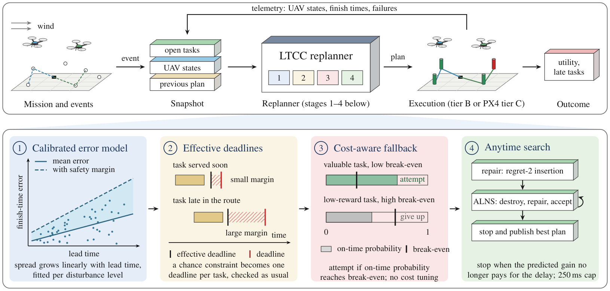
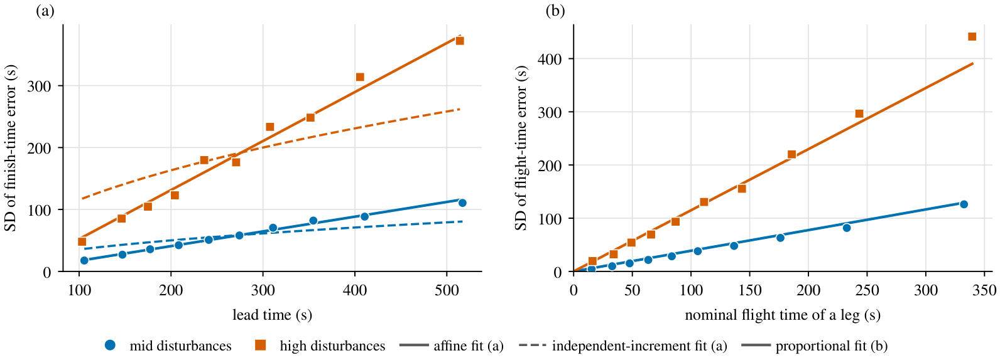
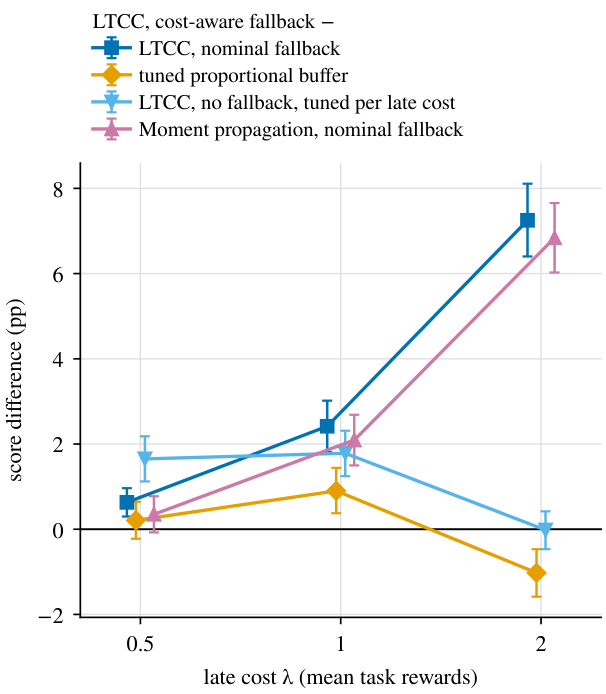
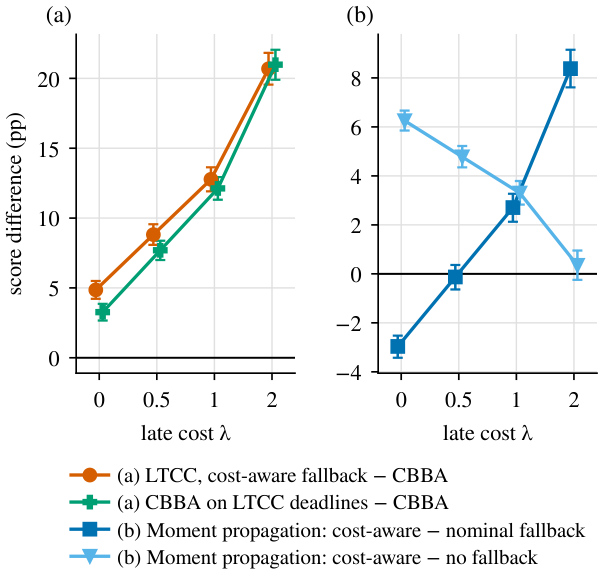
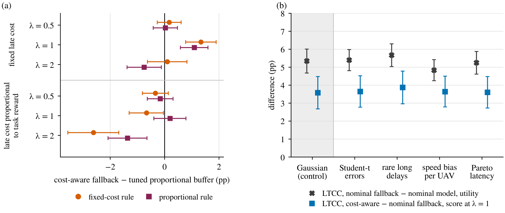
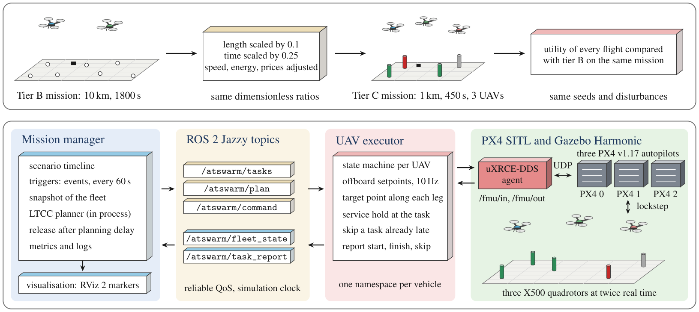
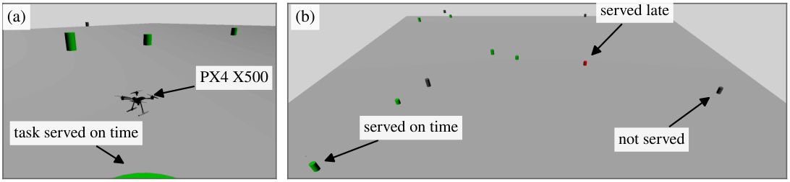
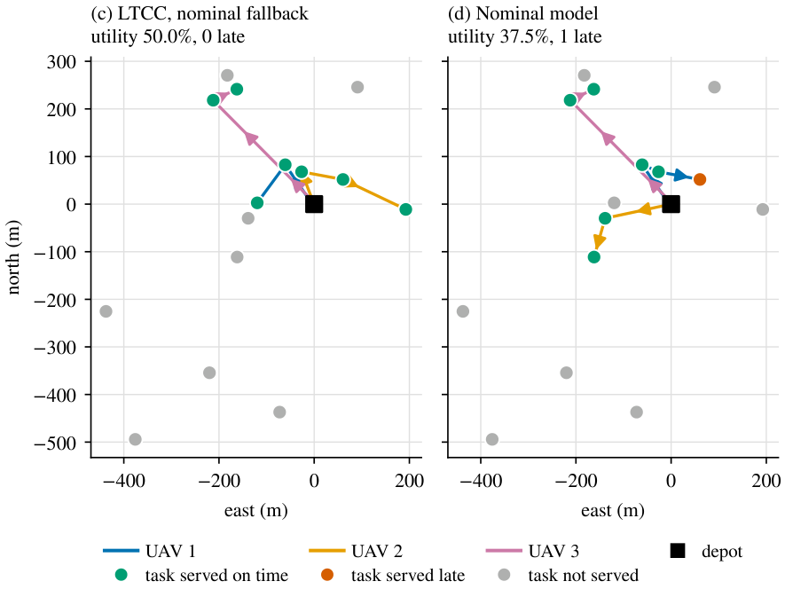

# LTCC: Lead-Time-Scaled Chance Constraints for Fast Multi-UAV Replanning

Code, protocols, raw results and manuscript sources of the paper

> **Lead-Time-Scaled Chance Constraints With a Cost-Aware Fallback for Fast Multi-UAV Replanning Under Uncertain
> Execution**
> Cao-Phuc Ha, Anh Nguyen Vu Minh, Phu-Nguyen Le
> FPT University and Vietnam Aerospace University, 2026 (manuscript under review)

LTCC is a replanner for teams of UAVs that serve tasks with deadlines while wind, speed and service-time errors delay
the plan. It keeps the fast heuristics of a nominal replanner (regret insertion, ALNS, CBBA) and changes only the
deadlines they check:

- **Effective deadline.** In the tested missions, the spread of the finish-time error was well approximated by an
  affine function of the lead time. A chance constraint on every task then reduces exactly to one deadline per task,
  computed with a single division.
- **Cost-aware fallback.** A task that the chance constraint gives up is attempted only if its probability of meeting
  the deadline reaches the break-even value `c / (w + c)` set by its reward `w` and the cost `c` of a late arrival,
  again in closed form and without cost-specific tuning.
- **Evaluation.** Seven studies on held-out missions, each with a protocol frozen with SHA-256 hashes before its runs,
  in a kinematic simulator (tier B) and in PX4 software-in-the-loop flights with Gazebo and ROS 2 (tier C).



*Overview of LTCC. Top: the replanning loop. Bottom: the four stages of one replanning call.*

## Main results

All results are paired differences on held-out missions (270 missions per tier B study), with 95% bootstrap intervals
and Holm correction within each study. pp = percentage points of the served reward.

| Comparison (tier B unless stated) | Score | Difference | Outcome |
|---|---|---|---|
| LTCC vs. nominal model (study 4) | utility | +5.07 pp [+4.63, +5.52] | supported |
| LTCC vs. constant 60 s buffer (study 4) | utility | +4.22 pp [+3.74, +4.68] | supported |
| LTCC vs. CBBA (study 6) | utility | +4.86 pp (+10.0%) | descriptive |
| LTCC vs. tuned proportional buffer / moment propagation (study 4) | utility | −0.38 / −0.25 pp | similar utility |
| Cost-aware vs. nominal fallback, late cost of one task reward (study 5) | u₁ | +2.42 pp [+1.81, +3.02] | supported |
| Cost-aware fallback vs. proportional buffer tuned for that cost (studies 5, 7a) | u₁ | +0.90 pp, +1.34 pp | supported |
| Advantage over the nominal model under four error departures (study 7b) | utility | +4.83 to +5.67 pp | supported, 4 of 4 |
| Tier C (PX4 SITL): fallback vs. no fallback (study 4C) | utility | +10.35 pp (+56%) | supported |
| Tier C (PX4 SITL): LTCC vs. nominal model (study 4C) | utility | −0.57 pp [−3.49, +2.29] | not supported |

The full list of the 28 pre-registered hypotheses and their outcomes is Table 4 of the paper.

<p align="center">
  
</p>

*Finish-time error on development missions: (a) standard deviation against lead time with the affine and the
independent-increment fit; (b) standard deviation of single legs against their nominal flight time.*

<p align="center">
  
  &nbsp;&nbsp;
  
</p>

*Left: score of LTCC with the cost-aware fallback minus each method against the late cost (study 5). Right: comparisons
with CBBA and the cost-aware fallback inside moment propagation (study 6).*



*Study 7: (a) cost-aware fallback minus the tuned proportional buffer for each score and late cost; (b) primary
comparisons under the calibrated errors and four departures from the error model.*

## Software-in-the-loop tier

Tier C flies rescaled tier B missions with three X500 quadrotors, each controlled by its own PX4 v1.17 autopilot, in
Gazebo Harmonic on ROS 2 Jazzy. The rescaling keeps every dimensionless ratio of the decision problem, so the same
mission can be compared across the two tiers.



<p align="center">
  
</p>
<p align="center">
  
</p>

*Illustrative flight on a development mission: Gazebo scene and PX4 trajectories of LTCC with nominal fallback and of
the nominal model on the same mission.*

## Repository structure

| Folder | Content |
|---|---|
| `journal_core/` | planner and models: effective deadlines, fallbacks, moment propagation, CBBA, kinematic executor (tier B) |
| `journal_ros/` | ROS 2 mission manager, UAV executor and batch scripts for PX4 SITL and Gazebo (tier C) |
| `experiments/` | grid runners, configurations (`configs/`), analysis and figure scripts |
| `docs/` | frozen protocols of every study (`*_PROTOCOL_*.md`) with their deviations |
| `results/` | raw held-out results, SHA-256 freeze lists, run logs |
| `models/` | fitted error models and stopping-rule predictors |
| `paper_journal/` | manuscript (`ieee/`), generated tables and numbers (`tables/`), figures (`figures/`, TikZ in `figures_src/`) |
| `tests/` | unit tests of the study code |
| `setup/`, `tools/` | environment installation, runners and helper scripts |

## Reproducing the paper

[REPRODUCE.md](REPRODUCE.md) lists, for every study, the protocol, the freeze commit, the seeds, the configuration, the
runner and the analysis script. Every number in the manuscript is a macro generated from the raw results; none is typed
by hand. Rebuilding all tables and figures from the stored results takes minutes; re-running the experiments takes
hours to days.

Environment: WSL2 Ubuntu 24.04, Python 3.11, ROS 2 Jazzy, PX4 v1.17, Gazebo Harmonic, Micro-XRCE-DDS-Agent v2.4.3.

## Citation

If you use this code or the results, please cite:

```bibtex
@unpublished{ha2026ltcc,
  author = {Ha, Cao-Phuc and Nguyen Vu Minh, Anh and Le, Phu-Nguyen},
  title  = {Lead-Time-Scaled Chance Constraints With a Cost-Aware Fallback for Fast Multi-{UAV} Replanning Under
            Uncertain Execution},
  note   = {Manuscript under review},
  year   = {2026}
}
```

## Contact

Cao-Phuc Ha (caophucai@gmail.com), Department of Artificial Intelligence, FPT University, Ho Chi Minh City, Vietnam.
Corresponding author: Phu-Nguyen Le (nguyenlp@vaa.edu.vn), Faculty of Electrical and Electronics Engineering, Vietnam
Aerospace University.
